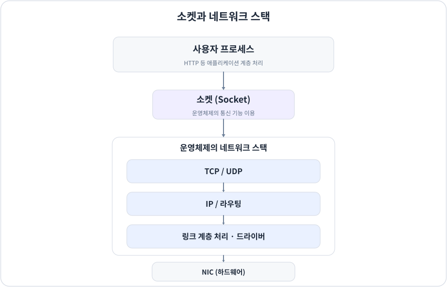
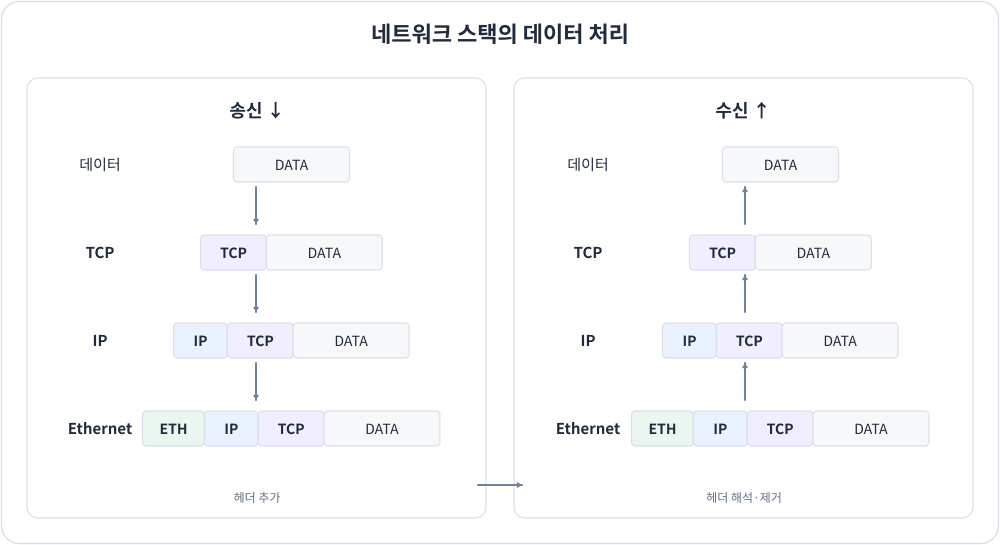
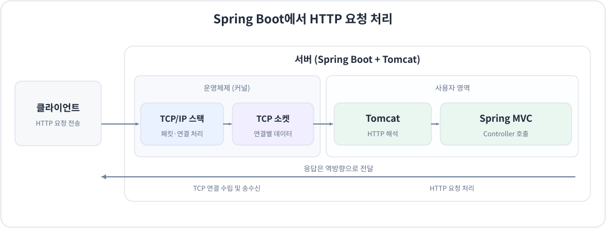
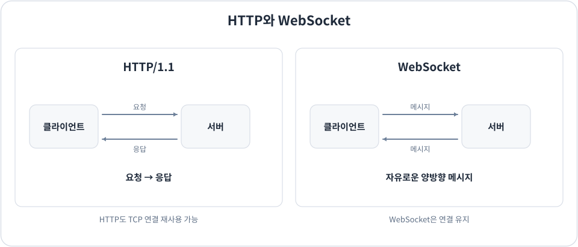

# 소켓(Socket)이란?

> 소켓이 무엇인지 공부하면서 이해한 내용을 내 언어로 정리한 노트.  
> 그림은 **개념을 이해하기 위한 단순화된 도식**이며, 실제 운영체제와 네트워크 장치의 구현은 더 복잡할 수 있다.

## 1. 소켓(Socket)

**정의:** 소켓(Socket)은 프로세스가 운영체제에서 제공하는 통신 기능을 이용하여 데이터를 송수신하기 위한 인터페이스이자 통신 끝점(Endpoint)이다.

소켓은 다양한 통신 방식에 사용될 수 있으며, 일반적으로 사용하는 TCP/UDP 소켓은 운영체제의 네트워크 스택을 이용하여 네트워크 통신을 수행한다

**핵심:** 소켓은 네트워크 스택을 *새로 구현하거나 자유롭게 수정*하는 수단이 아니라, **이미 구현되어 있는 통신 기능을 이용하는 수단**이다. 필요한 경우 소켓 옵션으로 일부 통신 동작을 설정할 수 있다.

> 엄밀히 말하면 소켓은 운영체제가 관리하는 통신 끝점이고, 소켓 API는 그 소켓을 만들고 사용하는 함수·인터페이스이다. 이 노트에서는 소켓을 **통신 인터페이스라는 관점**에서 설명한다.

## 2. 네트워크 스택(Network Stack)이란?

네트워크 통신에는 여러 계층이 있으며, 각 계층마다 담당하는 역할과 프로토콜이 존재한다.

네트워크 스택이라는 말은 계층적으로 구성된 **프로토콜의 집합**을 뜻하기도 하고, 그 프로토콜들을 실제로 구현한 **소프트웨어**를 뜻하기도 한다. 여기서는 **운영체제에 구현된 네트워크 스택**을 의미한다.

운영체제의 네트워크 스택은 네트워크 통신에 필요한 여러 하위 계층의 작업을 수행한다. 대표적으로 다음 작업들이 있다.

- TCP의 연결 수립·유지, 순서 보장, 재전송, 흐름 제어
- IP 주소 처리와 라우팅(다음 홉 및 출력 인터페이스 결정)
- ARP 등을 통한 이웃 장치의 주소 확인
- 데이터 링크 계층의 프레임 처리 및 네트워크 드라이버와의 연계

데이터를 **보낼 때**는 일반적으로 상위 계층에서 하위 계층으로 내려가면서 필요한 헤더 등을 추가한다. 이것을 **캡슐화(Encapsulation)** 라고 한다.

반대로 데이터를 **받을 때**는 하위 계층에서 상위 계층으로 올라가며 각 계층의 헤더를 검사·처리하고 데이터를 전달한다. 이것을 **역캡슐화(Decapsulation)** 라고 한다.

다만 **모든 계층의 모든 처리를 운영체제 소프트웨어 혼자 수행하는 것은 아니다.** HTTP 같은 애플리케이션 프로토콜은 보통 사용자 영역의 서버·라이브러리가 처리하며, 물리적인 송수신과 일부 헤더 처리에는 NIC 하드웨어도 관여한다.

## 3. TCP 소켓

**TCP 소켓은 TCP 프로토콜을 이용해 통신하는 소켓**이다.

우리가 TCP 소켓을 사용한다는 것은 TCP를 직접 구현한다는 뜻이 아니라, **운영체제에 이미 구현된 TCP/IP 네트워크 스택을 이용한다**는 뜻이다.

예를 들어 TCP 소켓으로 연결을 시도하면 운영체제의 TCP 구현이 **3-way handshake**, 연결 상태 관리, 순서 보장, 재전송, 흐름 제어 등을 담당한다. 그 아래의 IP와 링크 계층 처리도 네트워크 스택 및 관련 장치가 수행한다.

소켓은 일반적인 애플리케이션 개발에서는 TCP·UDP 통신에 가장 많이 사용되지만, **TCP/UDP 전용 인터페이스는 아니다.** 운영체제가 지원하는 다른 프로토콜(SCTP 등)이나 Raw/Packet Socket도 소켓 인터페이스로 이용할 수 있다.

## 4. Spring Boot와 소켓

Spring Boot로 만든 웹 애플리케이션도 하나의 프로세스로 동작한다. 일반적인 **Spring MVC + 내장 Tomcat + HTTP/1.1** 환경에서는 내부적으로 **Tomcat이 TCP 소켓을 사용**한다.

### 요청을 받을 때

1. Tomcat은 서버의 IP 주소와 포트 번호(예: `0.0.0.0:8080`)에 **리스닝 소켓을 바인딩(bind)** 하고 연결 요청을 기다린다(`listen`).
2. 클라이언트가 연결하면 운영체제의 TCP/IP 스택이 TCP 연결 수립과 데이터 수신 처리를 담당한다. 연결이 수락되면 **연결별 소켓**을 통해 통신한다.
3. Tomcat은 그 소켓에서 바이트 데이터를 읽고, 이를 **HTTP 프로토콜에 맞게 해석**한다.
4. Spring MVC의 `DispatcherServlet`은 해당 HTTP 요청을 처리할 컨트롤러 메서드를 찾아 호출한다.

### 응답을 보낼 때

1. Spring MVC에서 요청을 처리하고 응답 내용을 준비한다.
2. Tomcat과 Spring의 웹 처리 구성 요소들이 HTTP 응답을 만들어 소켓에 데이터를 쓴다.
3. 운영체제의 TCP/IP 스택이 TCP·IP·링크 계층 처리를 거쳐 클라이언트에게 전송한다.

### 그렇다면 운영체제는 HTTP를 알아야 할까?

**일반적인 TCP 전달 과정에서 운영체제는 데이터가 HTTP인지 알 필요가 없다.** TCP/IP 스택은 주소·포트·프로토콜·연결 정보를 이용해 데이터를 적절한 소켓으로 전달한다. 이를 HTTP 형식에 맞게 해석하는 것은 Tomcat 같은 **애플리케이션 계층 소프트웨어**의 역할이다.

운영체제는 *전송 계층만* 담당하는 것이 아니다. **TCP/UDP뿐 아니라 IP, 라우팅, 링크 계층 관련 처리에도 관여**한다. 반면 HTTP 같은 상위 애플리케이션 프로토콜은 보통 애플리케이션 측에서 구현한다.

> 즉, 일반적인 TCP 소켓은 애플리케이션이 **TCP의 복잡한 내부 동작을 직접 구현하지 않고** 네트워크 통신을 수행하도록 해주는 인터페이스라고 이해할 수 있다.

## 5. HTTP와 TCP 소켓의 관계

HTTP와 소켓을 서로 반대되는 통신 방식이라고 비교하는 것은 정확하지 않다.

- **HTTP:** 애플리케이션 계층에서 요청·응답의 형식과 의미를 정의하는 **프로토콜**
- **TCP:** 연결 지향적이고 신뢰성 있는 바이트 스트림을 제공하는 **전송 프로토콜**
- **TCP 소켓:** 애플리케이션이 운영체제의 TCP 통신 기능을 이용하는 **통신 끝점/인터페이스**

일반적인 **HTTP/1.1과 HTTP/2는 TCP 위에서 동작**하기 때문에 내부적으로 TCP 소켓을 이용한다. 

## 6. 번외: 소켓과 WebSocket의 차이

**WebSocket은 소켓 자체가 아니라 애플리케이션 계층의 프로토콜**이다.

일반적인 HTTP 통신은 클라이언트가 **요청**하고 서버가 그에 **응답**하는 방식이다. TCP 연결을 계속 유지하더라도 기본적인 HTTP 요청·응답 모델과 양방향의 자유로운 메시지 교환은 다른 개념이다.

반면 **WebSocket**은 연결을 유지한 상태에서 **전이중(Full-Duplex) 메시지 통신**을 지원한다. 연결이 수립된 후에는 클라이언트의 추가 요청이 없어도 서버가 독립적으로 메시지를 보낼 수 있다. 그래서 채팅, 실시간 알림, 실시간 시세 같은 서비스에 자주 사용된다.

전통적인 WebSocket 연결에서는 처음에 **HTTP/1.1 Upgrade 요청**으로 프로토콜 전환을 협의하고, 이후 **같은 TCP 연결**에서 WebSocket 메시지를 주고받는다.

단, **HTTP에서도 SSE(Server-Sent Events), 스트리밍 응답, Long Polling** 등으로 서버가 데이터를 지속적으로 전달하는 방식이 있다. 따라서 'HTTP는 서버에서 데이터를 먼저 보낼 수 없다'고 절대적으로 표현하지는 않는다.

## 7. 최종 정리

- **네트워크 스택:** 운영체제에 구현되어 하위 네트워크 프로토콜의 실제 동작을 처리하는 소프트웨어와 관련 구성 요소
- **소켓:** 프로세스가 운영체제가 제공하는 통신 기능을 이용해 데이터를 송수신하기 위한 통신 끝점이자 인터페이스
- **TCP 소켓:** 운영체제가 구현한 TCP 통신 기능을 이용하는 소켓
- **HTTP:** HTTP 요청·응답 규칙을 정의하는 애플리케이션 계층 프로토콜
- **WebSocket:** 연결을 유지하며 독립적인 양방향 메시지를 주고받도록 정의한 애플리케이션 계층 프로토콜

**내가 이해한 핵심:** 프로세스는 소켓을 통해 운영체제에 이미 구현된 네트워크 스택의 기능을 사용한다. 따라서 TCP 패킷 처리나 재전송 등을 직접 구현하지 않아도 되고, HTTP처럼 상위 프로토콜의 해석과 비즈니스 로직은 Tomcat·Spring 등의 애플리케이션 측에서 처리할 수 있다.

---

