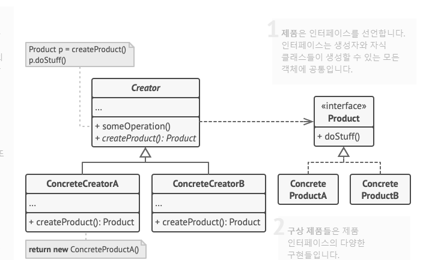

# 팩토리 패턴 - 단순 팩토리 패턴과 팩토리 메서드 패턴

## 팩토리 패턴이란?

객체를 사용하는 코드에서 객체 생성 부분을 분리하여, 객체의 생성을 별도의 메서드나 클래스가 담당하도록 하는 방식이다.

클라이언트가 필요한 객체를 직접 `new`로 생성하는 대신, 객체 생성을 담당하는 팩토리를 통해 객체를 얻는 것이다.

이렇게 하면 객체를 사용하는 코드에서는 어떤 구체적인 클래스를 생성하는지, 어떻게 생성하는지에 대한 내용을 줄일 수 있다. 실제 객체 생성은 팩토리 내부에서 `new`를 사용해도 된다.

'팩토리'는 넓은 표현이고, 단순 팩토리 패턴과 팩토리 메서드 패턴은 객체를 생성하는 방식에 차이가 있다.

## 1. 단순 팩토리 패턴 (Simple Factory Pattern)

객체 생성을 담당하는 하나의 팩토리 클래스를 두고, 전달받은 값에 따라 어떤 객체를 생성할지 결정하는 방식이다.

예를 들어 `Transport`라는 공통 인터페이스를 구현한 `Truck`, `Ship` 클래스가 있다고 하자.

```java
interface Transport {
    void deliver();
}

class Truck implements Transport {
    public void deliver() {
        System.out.println("트럭으로 운송");
    }
}

class Ship implements Transport {
    public void deliver() {
        System.out.println("배로 운송");
    }
}
```

클라이언트가 직접 `new Truck()`이나 `new Ship()`을 호출하는 대신, 다음과 같은 팩토리를 통해 생성할 수 있다.

```java
class TransportFactory {
    public static Transport create(String type) {
        if (type.equals("ROAD")) {
            return new Truck();
        } else if (type.equals("SEA")) {
            return new Ship();
        }
        throw new IllegalArgumentException("지원하지 않는 운송 방식");
    }
}
```

```java
Transport transport = TransportFactory.create("ROAD");
transport.deliver();
```

- 팩토리는 전달받은 값을 확인하고 그에 맞는 객체를 생성해 반환한다.
- 클라이언트는 구체적인 `Truck`, `Ship` 클래스를 직접 생성할 필요가 없다.
- 반환 타입을 `Transport`로 두면 클라이언트는 공통 인터페이스를 통해 객체를 사용할 수 있다.
- 정적(`static`) 생성 메서드를 자주 사용하지만, 반드시 정적이어야 하는 것은 아니다.

객체 생성 코드가 한곳에 모여 있어 관리하기 편하지만, 새로운 종류의 객체를 추가한다면 기존 팩토리의 조건문을 수정해야 할 수 있다.

## 2. 팩토리 메서드 패턴 (Factory Method Pattern)

상위 클래스에서 객체를 생성하는 메서드를 정의하고, 실제 어떤 객체를 생성할지는 하위 클래스에서 결정하도록 하는 패턴이다.

단순 팩토리처럼 하나의 팩토리가 조건문으로 생성할 객체를 결정하는 것이 아니라, 하위 클래스마다 생성 메서드를 오버라이딩하여 서로 다른 객체를 반환하도록 한다.

### 팩토리 메서드 패턴 구조



> 이미지 출처: [Refactoring.Guru — 팩토리 메서드 패턴](https://refactoring.guru/ko/design-patterns/factory-method)
> 
> 그림의 `Creator`는 객체 생성 메서드인 `createProduct()`를 정의하고, `ConcreteCreatorA/B`가 이를 오버라이딩해 실제 생성할 객체를 결정한다. `someOperation()`은 `createProduct()`로 얻은 객체를 사용하는 공통 동작이다. 생성된 객체는 `Product` 인터페이스를 통해 사용하므로 `Creator`는 구체적인 제품 클래스를 몰라도 된다.

아까의 `Transport`, `Truck`, `Ship`을 그대로 사용한다고 하자.

```java
abstract class Logistics {
    // 운송 방식과 관계없이 공통으로 수행하는 업무
    public void planDelivery() {
        validateOrder();
        prepareDelivery();

        Transport transport = createTransport();
        transport.deliver();
    }

    private void validateOrder() {
        System.out.println("주문 정보 검증");
    }

    private void prepareDelivery() {
        System.out.println("배송 준비");
    }

    // 실제 어떤 운송 수단을 만들지는 하위 클래스에서 결정
    protected abstract Transport createTransport();
}

class RoadLogistics extends Logistics {
    @Override
    protected Transport createTransport() {
        return new Truck();
    }
}

class SeaLogistics extends Logistics {
    @Override
    protected Transport createTransport() {
        return new Ship();
    }
}
```

클라이언트는 다음과 같이 사용할 수 있다.

```java
Logistics logistics = new RoadLogistics();
logistics.planDelivery(); // 트럭으로 운송
```

`RoadLogistics`를 사용하면 `createTransport()`에서 `Truck`이 생성되고, `SeaLogistics`를 사용하면 `Ship`이 생성된다.

여기서 `Logistics`는 운송 방식에 관계없이 주문 검증과 배송 준비를 공통으로 수행하고, 그다음 운송 수단을 생성해 `deliver()`를 호출한다. 하지만 실제 어떤 운송 수단을 생성하는지는 알 필요가 없다. 하위 클래스가 생성할 객체를 결정하기 때문이다.

중요한 점은 **상위 클래스의 공통 동작이 꼭 객체를 생성하거나 초기화하는 작업일 필요는 없다는 것**이다. `planDelivery()`처럼 생성된 객체를 이용해 어떤 업무를 수행하는 동작이어도 된다. 물론 객체 생성 과정의 공통 작업을 정의하는 경우에도 활용할 수 있다.

또한 상위 클래스의 이름이 반드시 `Factory`일 필요는 없다. `Logistics`처럼 원래의 업무를 수행하는 클래스가 팩토리 메서드를 가지고 있을 수도 있다.

- 상위 클래스는 생성할 객체의 공통 타입(`Transport`)만 알고 있어도 된다.
- 하위 클래스는 실제 생성할 객체(`Truck`, `Ship`)를 결정한다.
- 새로운 운송 방식을 추가할 때 새로운 하위 클래스를 만들어 확장할 수 있다. 다만 프로그램에서 그 하위 클래스를 선택하는 부분은 추가하거나 변경해야 할 수 있다.
- 자바에서 오버라이딩할 팩토리 메서드는 인스턴스 메서드로 정의한다. `static` 메서드는 오버라이딩할 수 없기 때문이다.

한편 `new RoadLogistics()`처럼 구체적인 팩토리 역할의 객체는 어딘가에서 생성해야 한다. 이 패턴의 목적은 프로그램에서 모든 `new`를 없애는 것이 아니라, **`Logistics`의 공통 로직이 `Truck`이나 `Ship` 같은 구체적인 객체 생성 방식에 직접 의존하지 않도록 하는 것**이다.

## 3. 두 패턴의 차이

| 구분 | 단순 팩토리 패턴 | 팩토리 메서드 패턴 |
|---|---|---|
| 객체 생성 방식 | 보통 하나의 팩토리가 인자값을 보고 결정 | 하위 클래스가 생성 메서드를 오버라이딩해서 결정 |
| 주로 사용하는 구조 | 팩토리 메서드 내부의 `if`, `switch` 등 | 상속과 다형성 |
| 공통 업무 로직 | 없어도 됨 | 상위 클래스에 둘 수 있음. 객체 생성과 무관한 업무여도 됨 |
| 새로운 종류의 객체 추가 | 기존 팩토리의 분기문을 수정할 수 있음 | 새로운 하위 Creator 클래스를 추가할 수 있음 |
| `static` | 자주 사용하지만 필수는 아님 | 오버라이딩하는 생성 메서드는 `static`이 아님 |

## 4. 공통점과 정리

팩토리 패턴은 객체를 사용하는 클래스가 구체적인 객체를 직접 생성하지 않고, 그 생성 책임을 별도의 팩토리나 하위 클래스에 맡기도록 하는 방식이다. 이를 통해 객체를 사용하는 코드가 구체적인 클래스와 생성 방법에 직접 의존하는 것을 줄일 수 있다.

이는 **단순 팩토리 패턴과 팩토리 메서드 패턴의 공통점**이다. 다만 생성할 객체를 **하나의 팩토리에서 선택하느냐**, 아니면 **하위 클래스가 결정하도록 하느냐**에 차이가 있다.

팩토리 패턴이 무조건 좋은 것은 아니다. 객체 생성이 단순하고 확장할 필요도 크지 않다면 오히려 클래스만 많아지고 구조가 복잡해질 수 있다.

> **핵심**: 단순 팩토리는 하나의 팩토리에서 생성할 객체를 선택하는 방식이고, 팩토리 메서드 패턴은 상위 클래스의 공통 로직을 유지하면서 실제 생성할 객체를 하위 클래스에 맡기는 방식이다.

### 참고

- Refactoring.Guru, [팩토리 비교](https://refactoring.guru/ko/design-patterns/factory-comparison)
- Refactoring.Guru, [팩토리 메서드 패턴](https://refactoring.guru/ko/design-patterns/factory-method)
