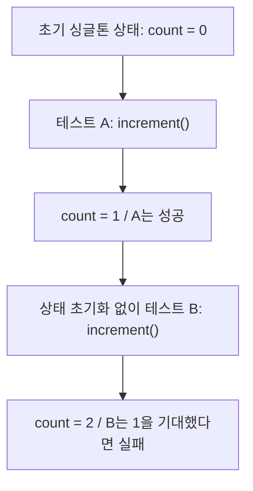

# 싱글톤 패턴 (Singleton Pattern)

## 1. 싱글톤 패턴이란?

하나의 클래스에 오직 하나의 인스턴스만 가지도록 하는 디자인 패턴이다.

일반적으로 하나의 클래스로 여러 개의 인스턴스를 만들 수 있지만, 싱글톤 패턴에서는 하나의 인스턴스만 생성되도록 제한한다. 그리고 그 인스턴스에 대한 전역적인 접근 방법을 제공해 여러 모듈에서 공유하며 사용한다.

### 장점

- 인스턴스를 한 번만 생성하기 때문에 동일한 인스턴스를 여러 개 만들 때 소요되는 시간을 줄일 수 있다.
- 불필요하게 여러 인스턴스를 만들지 않기 때문에 메모리 사용량도 줄일 수 있다.
- 여러 모듈에서 동일한 상태나 설정을 공유할 수 있다.


## 2. 싱글톤 구현

싱글톤을 구현하는 방법은 여러 가지가 있다. 다음은 **정적 중첩 클래스(Holder)를 이용한 방식**이다.

```java
public class Singleton {

    private Singleton() {}

    private static class SingletonHolder {
        private static final Singleton INSTANCE = new Singleton();
    }

    public static Singleton getInstance() {
        return SingletonHolder.INSTANCE;
    }
}
```

이 방식은 **지연 초기화(Lazy Initialization)** 와 **멀티스레드 환경에서의 안전한 초기화**를 함께 만족할 수 있다.

- `Singleton` 클래스가 초기화되었다고 해서 `SingletonHolder`까지 바로 초기화되는 것은 아니다.
- 처음 `getInstance()`를 호출하여 `SingletonHolder.INSTANCE`에 접근할 때 `SingletonHolder`가 초기화되고, 이때 싱글톤 인스턴스가 생성된다.
- JVM은 클래스 초기화가 스레드 안전하게 진행되도록 보장하므로, 여러 스레드가 동시에 접근하더라도 인스턴스가 중복 생성되는 문제를 막을 수 있다.

## 3. 싱글톤 사용 사례

### 데이터베이스 연결 관리

데이터베이스 연결과 관련된 객체를 하나만 생성하고 여러 모듈에서 공유하며 사용하는 방식이다.
데이터베이스 연결은 상대적으로 많은 자원이 소모되는 작업이고, 여러 모듈에서 동일한 연결 설정과 관리 기능을 사용할 수 있기 때문에 관련 객체를 불필요하게 여러 번 생성할 필요가 없다.

### 이 밖의 사례

- **캐시 관리:** 여러 모듈이 공통 캐시나 캐시 관리 객체를 공유하는 경우
- **로깅 설정 및 관리:** 여러 모듈에서 공통 로깅 설정과 관련 자원을 사용하는 경우
- **설정 관리:** 여러 모듈이 동일한 애플리케이션 설정을 사용하는 경우

=> 굳이 여러 번 만들 필요가 없다 -> 생성·관리 비용을 줄일 수 있다, 공통 상태 및 설정값을 사용한다.

단순히 변수 값이 같다는 이유만으로 반드시 싱글톤을 사용해야 하는 것은 아니다. **여러 곳에서 같은 인스턴스를 공유하는 것이 적절한지**가 중요하다.

## 4. 싱글톤의 단점

### 4.1. 결합도가 높아질 수 있음

싱글톤 클래스의 인스턴스를 다른 클래스에서 **직접 가져와 사용하는 경우**, 해당 싱글톤 클래스의 구체적인 구현 및 접근 방식에 강하게 의존하게 된다.

따라서 싱글톤 클래스가 수정될 경우 이를 사용하는 여러 클래스의 코드도 수정해야 할 수 있다. 또한 테스트에서 실제 객체를 Mock 객체로 교체하기도 어려울 수 있다.

```java
// 싱글톤 구현을 직접 사용하는 방식
public class UserService {

    public void saveUser() {
        DatabaseClient.getInstance().save();
    }
}
```

위 코드는 `UserService`가 `DatabaseClient.getInstance()`라는 구체적인 접근 방식에 직접 의존한다.

이 문제는 **싱글톤 인스턴스가 하나라는 사실 자체 때문에 생기는 것이 아니다.** 일반 클래스도 `new`로 특정 구현체를 직접 생성하면 똑같이 결합도가 높아질 수 있다. 다만 전통적인 싱글톤 패턴에서는 `getInstance()`로 인스턴스를 직접 가져와 사용하는 방식이 흔하기 때문에 이러한 문제가 발생하기 쉽다고 이해했다.

**추상화 + 의존성 주입(DI)** 을 활용하면 결합도를 낮출 수 있다.

```java
// Database는 인터페이스라고 가정
public class UserService {

    private final Database database;

    public UserService(Database database) {
        this.database = database;
    }

    public void saveUser() {
        database.save();
    }
}
```

이제 `UserService`는 특정 싱글톤 구현을 직접 가져오지 않고, 외부에서 전달받은 객체를 사용한다. 이때 주입되는 객체가 싱글톤 인스턴스여도 된다.

=> **싱글톤이어서 반드시 결합도가 높은 것이 아니라, 구체적인 싱글톤 구현에 직접 의존하는 방식이 문제**인것 같다.

### 4.2. 공유되는 상태로 인해 단위 테스트가 어려울 수 있음

단위 테스트에서는 **각 테스트가 서로 독립적이어야 한다.** 즉, 하나의 테스트가 다른 테스트의 결과에 영향을 주면 안 되며, 실행 순서를 바꾸어도 각 테스트의 결과가 달라지지 않아야 한다.

그런데 싱글톤 인스턴스는 여러 곳에서 공유되는 객체이기 때문에, **변경 가능한 상태(인스턴스 변수 등)**를 가지고 있다면 문제가 생길 수 있다.

하나의 테스트에서 싱글톤 인스턴스의 상태를 변경했을 때 그 값이 그대로 남아 있으면, 같은 싱글톤을 사용하는 다른 테스트의 결과가 달라질 수 있기 때문이다.

예를 들어 `count`가 0으로 시작하는 싱글톤 객체를 두 테스트가 사용한다고 해 보자.



- 테스트 A만 단독으로 실행하면 성공할 수 있다.
- 테스트 B도 단독으로 실행하면 성공할 수 있다.
- 그런데 A 다음 B를 실행한다면 B가 실패할 수 있다.

이런 경우 테스트를 시작하기 전에 상태를 초기화하거나, 테스트마다 독립적인 객체를 사용하도록 설계해야 한다.


## 5. 정리

싱글톤 패턴은 하나의 인스턴스를 만들어 여러 곳에서 공유하기 위한 패턴이다. 반복적인 객체 생성 비용과 메모리 사용량을 줄이거나, 공통 상태와 자원을 관리하는 데 사용할 수 있다.

하지만 구체적인 싱글톤을 직접 가져오는 방식은 클래스 간 결합도를 높일 수 있고, 싱글톤에 가변 상태가 있다면 테스트 간 독립성이 깨질 수 있다.

> 관련해서 더 공부할 주제: 의존성 주입(DI), 의존성 역전 원칙(DIP), Spring의 싱글톤 빈과 IoC 컨테이너
